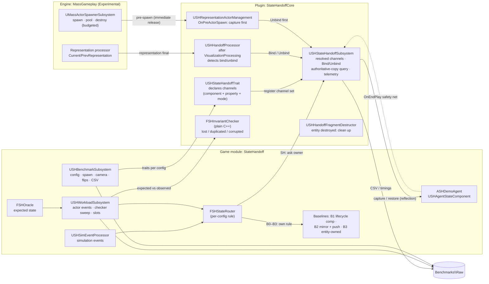

# 02 · System Architecture: StateHandoff (v1.0, final)

**Phase:** 3 (Architecture), **final**, 2026-11-21.
**Engine:** UE 5.8.4. Every engine behaviour relied on here is verified in [01b_Research_Findings.md](01b_Research_Findings.md); references like `01b #3` point to its §1 table. Engine paths are relative to `Engine/`, with `MG/` = `Plugins/Runtime/MassGameplay/Source/`, as in `01b`.
**Rule:** this is the design *before* code (Phase 3). If implementation proves a decision wrong, this file is updated in the same step, and §14 records the change.

---

## 1. Goals and non-goals

**Goals**
1. An explicit **ownership contract** per piece of non-spatial state: who holds the authoritative copy in each representation (actor / instanced mesh / none).
2. A **generic hand-off**: a state field is declared once (component class + property name), with no per-actor-class copy code.
3. Ownership moves only at the **representation commit**, on every path Mass uses to release or reuse an actor: queued release, immediate template-swap release, kept-disabled re-enable, pooling, destruction behind Mass's back.
4. An **invariant checker** that classifies every divergence and counts it per 1,000 transitions, identically for every configuration, and that is proven to detect faults (fault injection).
5. All five configurations (B0–B3, SH) in **one build**, with an identical workload, chosen on the command line.
6. The reusable parts (contract, hand-off, checker core) in a **plugin**; the workload and baselines in the game module. The checker's classification is **testable without a world**.

**Non-goals (v1)**
- Multiplayer: no Iris path for Mass entities in 5.8.4 (`01b #12`).
- State already owned by Mass-native systems: Mass StateTree, Mass Smart Object claims (`01b #2`).
- Real GAS, blackboard or perception adapters (growth path, §11). The demo's four channels stand in for them.
- Moving the agents: the engine already translates spatial data (`01b #1`).
- Save games. Channels could double as persistence records later (§11).

## 2. The core idea in plain words

Every agent has **two homes** for its state: fragments on the Mass entity, which always exist, and fields on an actor component, which exist only while Mass gives the agent an actor. A **contract** says, for each state field, which home is authoritative:

| Ownership mode | Authoritative copy | Hand-off |
|---|---|---|
| `EntityOwned` | Always the entity fragment. Actor-side code reads and writes the entity | None |
| `ActorWhileBound` | The actor component while the entity is **bound**; the entity fragment otherwise | Capture (actor → entity) on unbind, restore (entity → actor) on bind |

**Bound** has one precise meaning, read from Mass's own state at the commit point:

```text
Bound(entity) = actor  if  CurrentRepresentation is HighResSpawnedActor or LowResSpawnedActor
                       and FMassActorFragment holds a valid actor
                       and the entity is not waiting for actor visual readiness
              = none   otherwise (ISM, None, disabled kept actor, actor not ready yet)
```

Every frame, once Mass has finalised the representation (after `Representation.VisualizationProcessing`, the group the engine header tells consumers to wait for, `01b #3`), the hand-off processor compares each entity's bound actor with the one it recorded last frame:

```text
was A, now none   → capture A → entity;  entity owns
was none, now B   → restore entity → B;  B owns
was A, now B      → capture A, restore B
```

Two other paths release actors where the processor can't see them in time, so they capture first:
- **Template swap:** `OnPreActorSpawn` releases the old actor *immediately* before the new one spawns (`01b #6`). Our actor-management subclass captures, then calls the engine.
- **Anything else** (an actor destroyed by gameplay, the entity destroyed): an `AActor::OnEndPlay` safety net captures if the actor still owns state.

Each step is idempotent: a capture or restore that already happened is not repeated, because the bookkeeping fragment records who owns the state.

**Rejected alternatives** (more in §13):

| Alternative | Why we rejected it |
|---|---|
| Hand off in `BeginPlay`/`EndPlay` (Epic's PersistenceLab pattern) | Wrong clock: Mass releases actors at the end of the phase or frames later, and pooled actors get neither event (`01b #3–4`). Kept as baseline **B1**, made pool-aware |
| Mirror every frame (translator style) | Cost is paid every frame per actor even with no transitions, and writes after the copy in the release frame are lost (H3). Kept as baseline **B2** |
| Keep everything on the entity | The right answer when you own the actor-side system, and supported as `EntityOwned`. Not possible for systems you don't control (GAS, blackboards). Kept as reference **B3** |

## 3. Modules and where they live

```text
D:\UNREAL PORTFOLIO\P09_StateHandoff\StateHandoff\          ← the UE project
├── StateHandoff.uproject                                   (plugins: StateHandoffCore, MassGameplay)
├── Source\StateHandoff\{Public,Private}\                    ← game module: workload, baselines, benchmark only
├── Plugins\StateHandoffCore\Source\StateHandoffCore\{Public,Private}\   ← the reusable system
└── Config\  Content\
D:\UNREAL PORTFOLIO\P09_StateHandoff\Tools\                  ← build/package/smoke scripts, Python stats and run scripts
```

| Module | Type | Responsibility | Depends on |
|---|---|---|---|
| `StateHandoffCore` (plugin) | Runtime | Contract types, the hand-off trait, subsystem, commit processor, actor management, checker core | `Core`, `CoreUObject`, `Engine`, `MassEntity`, `MassCore`, `MassSpawner`, `MassActors`, `MassRepresentation` (added with the first code that includes them; the plugin descriptor already depends on the `MassGameplay` plugin) |
| `StateHandoff` (primary game module) | Runtime | Demo agent and state, Mass processor subclasses that drive representation, event generator, oracle, checker sweep, baselines B1–B3, benchmark director | `StateHandoffCore` and the Mass modules above, plus `MassLOD`, `MassCommon` |
| `Tools\` | Batch + Python | Build, package, smoke; later CSV statistics and the run orchestrator (pinned to P-cores, `Tools\cpu_affinity.py`) | — |

**The dependency rule:** game → plugin, never the reverse. The plugin knows nothing about the demo channels, baselines, events or benchmarks.

**Naming:** prefix `SH` for all types (`USH…`, `FSH…`, `ASH…`, `ESH…`). The plugin is `StateHandoffCore` because module names must be unique per project. Public headers use 5.8's export pattern `#define UE_API STATEHANDOFFCORE_API … #undef UE_API`, as the Mass headers do (e.g. `MassRepresentationActorManagement.h:7, 140`).

## 4. Classes

### 4.1 Plugin `StateHandoffCore` (7 pieces, each with a reason)

| Class | Kind / base | Responsibility | Why it exists, and what we rejected |
|---|---|---|---|
| Contract types (`SHContractTypes.h`) | `UENUM ESHOwnershipMode { EntityOwned, ActorWhileBound }`; `USTRUCT FSHChannelFragment : FMassFragment { uint32 Version; }`; `USTRUCT FSHChannelSpec { TSubclassOf<UActorComponent> ComponentClass; FName PropertyName; ESHOwnershipMode Mode; }`; `USTRUCT FSHHandoffFragment : FMassFragment { TWeakObjectPtr<AActor> BoundActor; bool bActorOwns; }`; `USTRUCT FSHChannelSetFragment : FMassConstSharedFragment { int32 ChannelSetIndex; }`; `USTRUCT FSHHandoffTag : FMassTag` | The vocabulary of the contract. Every channel's state struct derives from `FSHChannelFragment`, so the same struct type is both the entity fragment and the component property, and every write bumps `Version` | *Rejected:* one fragment holding a `TArray<FInstancedStruct>` of all channels (a heap allocation and pointer chase per entity; it defeats Mass's chunked struct-of-arrays layout) |
| `USHStateHandoffTrait` | `UMassEntityTraitBase` | Declares the channels (`TArray<FSHChannelSpec>`). `BuildTemplate` registers the channel set with the subsystem and adds `FSHHandoffFragment`, each channel's fragment type if missing (`HasFragment` / `AddFragment(FConstStructView)`, `01b` §4), the const shared fragment with the set index, and the tag. Reaching a world subsystem and creating a shared fragment inside `BuildTemplate` follows the engine's own visualization trait (`UWorld::GetSubsystem` and `EntityManager.GetOrCreateSharedFragment`, `MG/MassRepresentation/Private/MassVisualizationTrait.cpp:71–84`), including its rule to skip side effects when `BuildContext.IsInspectingData()` is true (editor inspection, `:73–78`). `ValidateTemplate` rejects a spec whose property is missing, isn't a struct derived from `FSHChannelFragment`, or is declared twice | Traits are how Mass composes entity types, so declaring a channel is one data entry, not code (goal 2). *Rejected:* a C++ registration call per actor class, which is exactly the per-class code we want to remove |
| `USHStateHandoffSubsystem` | `UWorldSubsystem` (Game and PIE worlds only) | Owns the **resolved channel sets** (`UScriptStruct*`, `FStructProperty*`, component class, mode), performs `Bind` (restore) and `Unbind` (capture), answers the gameplay query "where is the authoritative copy of channel T for this entity?", keeps an actor → entity map for the `OnEndPlay` safety net, collects per-frame telemetry and per-transition timings, and holds the fault-injection switches (non-Shipping builds only) | Its lifetime is the world's, which is the lifetime of the entities and actors it connects. Resolving properties once (at template build) keeps reflection out of the per-transition path. *Rejected:* putting this in the processor, which game code can't reach; a manager actor (can be destroyed or duplicated) |
| `USHHandoffProcessor` | `UMassProcessor`, PrePhysics, `ExecuteAfter Representation.VisualizationProcessing`, game thread | Each frame: for every entity with `FSHHandoffTag`, compute `Bound` (§2) from `FMassRepresentationFragment` and `FMassActorFragment`; compare with `FSHHandoffFragment::BoundActor`; queue unbinds and binds; after the chunk loop, ask the subsystem to perform them; publish telemetry once | The commit point (`01b #3`). It runs before the end of the phase, so an actor whose release was queued this frame is still alive to capture from. The hand-offs run after the chunk loop because channel fragment types are chosen by data and are not part of the query |
| `USHRepresentationActorManagement` | `UMassRepresentationActorManagement` | Overrides `OnPreActorSpawn`: if the entity is bound to the actor the engine is about to release immediately, unbind (capture) first, then call `Super` | The only release that happens before our processor can see it (`01b #6`). Set per entity type through `FMassRepresentationParameters::RepresentationActorManagementClass` |
| `USHHandoffFragmentDestructor` | `UMassObserverProcessor` on removal of `FSHHandoffFragment` | When an entity is destroyed, drop its actor → entity entry and the `OnEndPlay` binding | Without it, a destroyed entity would leave a dangling entry for a pooled actor that is later reused |
| `FSHInvariantChecker` | Plain C++ class | Compares an expected and an observed channel state (same struct type) and classifies: **None**, **Lost** (observed version behind), **Duplicated** (ahead), **Corrupted** (same version, different value, compared with `UScriptStruct::CompareScriptStruct`, `Source/Runtime/CoreUObject/Public/UObject/Class.h:2481`). Counts incidents by class and by the transition kind that preceded them | Pure logic, so it is unit-tested with hand-made structs and no world (goal 6). It is the *instrument*; it is built and used for the baselines **before** the hand-off code exists (`03`) |

**Console variables** (`ECVF_Default`):

| Cvar | Meaning |
|---|---|
| `sh.FaultInject` | Bitmask, non-Shipping only: 1 skip commit capture, 2 skip commit restore, 4 skip pre-spawn capture, 8 skip end-play capture (SC2) |
| `sh.Debug` | On-screen counters and per-agent text (S8) |

**Telemetry:** CSV category `StateHandoff`, published once per frame: `Binds`, `Unbinds`, `PreSpawnCaptures`, `SafetyNetCaptures`, `MissedCaptures` (bound actor already gone; must stay 0), `HandoffUs`, `BoundActors`. Per-transition timings go into a preallocated array, summarised at the end of the run (median, p95, p99, max).

### 4.2 Game module `StateHandoff` (11 pieces)

| Class | Base | Responsibility |
|---|---|---|
| Demo state (`SHDemoState.h`; the agent id and tag are in `SHDemoTypes.h`) | USTRUCTs deriving `FSHChannelFragment`: `FSHHealthState`, `FSHCooldownState`, `FSHMemoryState`, `FSHReservationState`; `FSHEvent`, `FSHWrite`, `FSHSlotRegistry`; free functions `SHDemo::MakeEvent`, `Decide`, `ApplyWrite` | The four channels of `01` §6.1. An event is **decided once**, on the oracle's state, into a write (`Decide`); **one** pure function applies that write to a copy and bumps its version (`ApplyWrite`). The live copy and the oracle get the same write, so a correct hand-off gives bit-identical results (S2a, §14) |
| `USHDemoStateTrait` | `UMassEntityTraitBase` | Adds the four channel fragments, the agent id and the tag in **every** config, so archetypes differ only by what each config adds (memory fairness, SC7) |
| `ASHDemoAgent` | `AActor`, `IMassActorPoolableInterface` | A mesh, a `USHAgentStateComponent`, a `USHLifecycleComponent`. `CanBePooled` follows `-SHPooling=` |
| `USHAgentStateComponent` | `UActorComponent` (no tick) | The demo's "actor-side system": the four state structs as `UPROPERTY`s, so SH's reflection channels can find them |
| `USHLifecycleComponent` | `UActorComponent` | **Baseline B1**, active only when `-SHConfig=B1`: hydrate in `BeginPlay` (retry next tick until the actor→entity mapping exists) and `PrepareForGame`; dehydrate in `EndPlay` and `PrepareForPooling`; a hydrated flag that the router reads. Epic's PersistenceLab pattern, made pool-aware (`01b #10`) |
| `USHB2MirrorProcessor` + `USHB2ActorManagement` | `UMassProcessor` (`SyncWorldToMass`, game thread, needs `FSHMirrorTag`) + `UMassRepresentationActorManagement` | **Baseline B2**: copy every channel actor → entity every frame; push entity → actor in `OnPostActorSpawn`. The tag is added only in B2, so the processor matches nothing in other configs |
| `USHVisualizationProcessor`, `USHVisualizationLODProcessor`, `USHLODCollectorProcessor` | `UMassVisualizationProcessor`, `UMassVisualizationLODProcessor`, `UMassLODCollectorProcessor` | Make Mass representation run for our tag, with `bAutoRegisterWithProcessingPhases = true`, exactly as MassCrowd does (`01b #13`) |
| `USHSimEventProcessor` | `UMassProcessor`, group `Behavior`, `ExecuteBefore Representation`, game thread | The **simulation event point**: entity-side gameplay events, routed by the config's rule |
| `USHObserverProcessor` | `UMassProcessor`, `ExecuteAfter Representation.VisualizationProcessing` | Counts transitions by kind in **every** config, from `FMassRepresentationFragment` and a 1-byte "last seen" fragment. The checker's denominator never depends on the system under test |
| `FSHStateRouter`, `FSHOracle`, `FSHSlotRegistry` | Plain C++ | Router: per config, which copy is authoritative (B0/B2: the actor's if the entity has an actor, else the entity's; B1: the actor's if hydrated; B3: always the entity's; SH: the subsystem's answer). Oracle: the expected state per agent. Slot registry: the M shared interaction slots |
| `USHWorkloadSubsystem` | `UTickableWorldSubsystem` (ticks after the director) | The **actor event point** (after physics), the checker sweep (every agent, every channel, via the router, compared with the oracle; incidents counted, then the oracle re-synced so each root cause counts once), reservation invariants (double-held, leaked), workload CSV stats |
| `USHBenchmarkSubsystem` | `UTickableWorldSubsystem` (Game/PIE) | The **director**: reads `-SH…=` values; builds the entity config in code (`FMassEntityConfig::AddTrait`, `01b` §4) with the traits each config needs and the right actor-management class; spawns N entities from a seed; drives the camera path and the flips; fires `CSV_EVENT`s `BenchStart`, `BenchFlip`, `BenchEnd`; writes CSV metadata and the end-of-run report; dumps `mass.LogArchetypes` / `obj list` for the memory table |

**Command line** (read by the director, as in UE5-UpdateBudget): `-SHConfig=B0|B1|B2|B3|SH`, `-SHAgents=`, `-SHSeed=`, `-SHPooling=0|1`, `-SHKeepLowRes=0|1`, `-SHCheck=0|1`, `-SHFlipEvery=<s>`, `-SHWarmup=<s>`, `-SHCapture=<s>`, `-SHFault=<mask>`, `-SHRunTag=`.

## 5. Overview diagram



## 6. Per-frame flow

```mermaid
sequenceDiagram
  participant SP as Actor spawner (Mass)
  participant SIM as USHSimEventProcessor
  participant REP as Representation processor (Mass)
  participant HP as USHHandoffProcessor
  participant SUB as USHStateHandoffSubsystem
  participant WL as USHWorkloadSubsystem
  Note over SP,HP: TG_PrePhysics: Mass PrePhysics phase
  SP->>SUB: OnPreActorSpawn (via USHRepresentationActorManagement): Unbind old actor before immediate release
  SP->>SP: spawn or take from pool (budgeted 1.5 ms)
  SIM->>SUB: simulation events: write the authoritative copy
  REP->>REP: CurrentRepresentation decided; actors enabled, disabled, release queued
  HP->>HP: per entity: Bound now vs BoundActor
  HP->>SUB: Unbind(A): capture A → fragments ; Bind(B): restore fragments → B
  SP->>SP: end of phase: queued releases → pool (PrepareForPooling) or destroy (EndPlay → safety net)
  Note over WL: after TG_PostPhysics: tickable subsystems
  WL->>SUB: actor events: write the authoritative copy
  WL->>WL: checker sweep: observed (router) vs oracle, classify, re-sync
```

### Hand-off, in code-sized pseudocode (the real code mirrors this)

```text
Processor, per entity:                                    // only reads; no structural changes
    Now = IsActorRep(Rep.Current) && Actor.IsValid() && !Rep.IsWaitingForActorVisualReadiness() ? Actor : null
    if Now != Handoff.BoundActor: PendingChanges.Add(Entity, Handoff.BoundActor, Now)
After the chunk loop:  for each change: if Old: Unbind(Entity, Old);  if Now: Bind(Entity, Now)

Unbind(Entity, Actor):  if !Handoff.bActorOwns: return                       // idempotent
    if Actor gone: ++MissedCaptures; else for each ActorWhileBound channel c:
        copy  Actor.Component(c).Property(c)  →  Fragment(c)                 // UScriptStruct::CopyScriptStruct (Class.h:2491)
    Handoff = { BoundActor = null, bActorOwns = false };  remove OnEndPlay binding
Bind(Entity, Actor):    if Handoff.bActorOwns: return
    for each ActorWhileBound channel c:  copy  Fragment(c)  →  Actor.Component(c).Property(c)
    Handoff = { BoundActor = Actor, bActorOwns = true };  add OnEndPlay binding
```

`Class.h` = `Source/Runtime/CoreUObject/Public/UObject/Class.h`. The component is found with `AActor::FindComponentByClass` (`Source/Runtime/Engine/Classes/GameFramework/Actor.h:3788`), once per component class per hand-off. The restore overwrites the whole struct, version included, so a pooled actor's leftover values from another entity can never survive a bind (H4).

## 7. Defaults and why

| Setting | Default | Reasoning |
|---|---|---|
| Ownership of the four demo channels in SH | `ActorWhileBound` | The same ownership as B0–B2, so SH is compared on the hand-off alone. `EntityOwned` is what B3 measures |
| Commit point | `ExecuteAfter Representation.VisualizationProcessing`, PrePhysics | The engine's documented "representation is final" group, before queued releases are processed (`01b #3`) |
| Bound while waiting for visual readiness? | No | The actor exists but is disabled and the mesh is shown; the entity keeps ownership until the actor is really enabled |
| Kept-disabled actors (`bKeepLowResActors`) | Entity owns the state | The actor isn't simulated but its components may still tick (`01b #5`); one owner only |
| `bKeepLowResActors` in the workload | `true` (engine default), with one `false` variant for H2 | Test the default, then isolate the hypothesis |
| Pooling | Measured both off and on; **on** for timing runs | Pooling is what performance-minded projects use, and it is the path lifecycle code misses |
| Agents | N = 1,000 and 4,000 | 4,000 is a crowd-sized load that keeps a flip heavy; 1,000 shows scaling. Higher N adds ISM/None transitions, not new paths |
| LOD counts and distances | Fixed in S3 by calibration | The defaults allow only about 150 actors (`01b #14`); calibration targets ≥ 20,000 transitions per correctness batch per config (SC1) |
| Event rate | 2% of agents per event point per frame (calibrated in S3) | About 1.2 events per agent per second at 60 fps per point: enough to change state between most transitions |
| Shared slots | M = N / 4 | Enough contention that claims fail sometimes, so the reservation logic is exercised |
| Flips | Every 4 s; every third flip "bounces" back after 10 frames | Mass flips plus quick returns inside the destruction window (H1, H5) |
| Checker | On in correctness runs, off in timing runs | The instrument must not add cost to the numbers it doesn't measure |

## 8. Lifetime and safety rules

| Risk | Rule | Evidence |
|---|---|---|
| Fragment references become invalid when an entity changes archetype (tags, release) | Never keep a fragment pointer or reference across a call that may move the entity; store `FMassEntityHandle`s and re-read | Engine warning `MassRepresentationActorManagement.h:115–116`, `.cpp:77–80` |
| The bound actor is destroyed before we capture | `TWeakObjectPtr`; the `OnEndPlay` safety net captures first; a capture from a dead actor is counted as `MissedCaptures` (must stay 0) | `01b #6` |
| An actor is released immediately (template swap) | `USHRepresentationActorManagement::OnPreActorSpawn` captures before `Super` | `MassRepresentationActorManagement.cpp:72–89` |
| A pooled actor is reused for another entity | Restore overwrites every `ActorWhileBound` channel; the actor → entity map is updated on bind; the destructor observer removes entries for destroyed entities | `01b #4` |
| A disabled kept actor still ticks components | It is not bound; on re-enable its copy is overwritten by restore. Actor-side logic must not act on state while unbound (documented in `07`) | `01b #5` |
| Channel fragments are not in the processor's query | All hand-offs run on the game thread, after the chunk loop; every processor that touches channel fragments is explicitly ordered before `Representation` or after the hand-off processor. **[to verify in S5]** with the processor dependency dump that this ordering holds under parallel processing | `MassProcessor.h:258`; ordering via `ExecutionOrder` |
| Subsystem access from a processor | The subsystem has no `TMassExternalSubsystemTraits` specialisation, so Mass treats it as game-thread-only | `Source/Runtime/Mass/MassCore/Public/Mass/ExternalSubsystemTraits.h:26–36` |
| Hand-off code in `BeginPlay` | Not allowed: the actor→entity mapping doesn't exist yet | `01b #7` |
| Subsystem in editor worlds | `DoesSupportWorldType`: Game and PIE only | as in UE5-UpdateBudget |
| World teardown mid-flip | `Deinitialize` removes all `OnEndPlay` bindings and clears the map; no capture (the entities are going away too) | — |
| Fault injection reaching a release build | Compiled only when `!UE_BUILD_SHIPPING` | — |

## 9. One workload, five configurations

The workload must be identical in every configuration. Only *where state lives* and *who copies it* change.

| Config | Traits added by the director | Actor management | Who copies state | Router rule |
|---|---|---|---|---|
| B0 | demo state, visualization, LOD | engine default | nobody | actor's copy if the entity has an actor, else entity's |
| B1 | same | engine default | `USHLifecycleComponent` (`BeginPlay`/`EndPlay`/pool callbacks) | actor's copy if hydrated, else entity's |
| B2 | same + `FSHMirrorTag` | `USHB2ActorManagement` | mirror every frame; push on spawn | actor's copy if the entity has an actor, else entity's |
| B3 | same | engine default | nobody (no actor copy is ever used) | always the entity's |
| SH | same + `USHStateHandoffTrait` | `USHRepresentationActorManagement` | the hand-off processor, pre-spawn capture, safety net | the subsystem's answer |

**Measuring correctness identically:** the checker reads each agent's state through the config's own router (what that config's gameplay would see), compares it with the oracle, and counts transitions with its own observer processor. The same events reach every config, in the same order, from the same seed.

## 10. C++ vs Blueprint

| C++ | Blueprint |
|---|---|
| Everything: contract, hand-off, checker, workload, baselines | Nothing in v1. A channel is declared in the trait's details panel (data, not code), which is the designer-facing part. Blueprint actor-side systems could be channels too (their struct variables are reflected), but that is not measured here |

## 11. How it grows into a production game (not built now)

- **Adapters for non-reflected systems:** a channel spec could name an adapter class with virtual capture/restore, for GAS attributes and active effects, blackboard keys or perception memory. The contract, timing and checker stay the same.
- **Persistence:** channels already are the "what must survive" list; a save system can serialise the authoritative copy (Epic's PersistenceLab and Instanced Actors persistence are the starting points).
- **Multiplayer:** when Mass entity replication lands on Iris, the server owns the contract and clients receive state through the entity; the hand-off becomes server-side only.
- **Editor validation:** a rule for UE5-GameplayLint: "actor component state on a Mass-represented actor that is not declared in any hand-off contract".
- **Batching:** captures in one flip frame could run grouped by component class or in parallel once the actor reads are proven thread-safe; only with data from SC4/SC5.

## 12. Known limits (stated, not hidden)

1. **Reflection channels need a `UPROPERTY` struct field on a component.** Non-reflected state needs the adapter of §11.
2. **The checker needs a version field per channel.** That is a test-time requirement on the demo state.
3. **Unbound actor-side logic is not prevented.** A disabled kept actor's components may still change their own copy or act on it; the restore fixes the copy, not the actions. It is documented, and the checker sees the copy.
4. **One frame granularity.** Ownership changes once per frame at the commit point; a write made between the release decision and the commit inside the same Mass phase goes to the entity.
5. **Single-player, Standalone execution flags only.**
6. **Experimental engine APIs**, pinned to 5.8.4.
7. **Not real GAS or blackboards.** The four demo channels stand in for them; v1 builds no adapter (owner decision, 2026-11-21). The results will show that the contract, the commit-time hand-off and the checker work for reflected component state. They will not show that GAS's own state (active effects, granted abilities) moves the same way. The adapter is a growth path: `12`.

## 13. Rejected alternatives (in full)

| Alternative | Why not |
|---|---|
| Lifecycle hand-off (`BeginPlay`/`EndPlay`) | Ties ownership to actor lifetime, which Mass decouples from the representation (`01b #3–4`). Measured as B1 |
| Per-frame mirror (translator pattern) | Cost every frame per actor and per channel; a loss window in the release frame. Measured as B2 |
| Entity-owned only | Best when possible (supported as `EntityOwned`; measured as B3), but impossible for actor-side systems you don't own |
| Subclass `UMassActorSpawnerSubsystem` (`ReleaseActorToPool` and `SpawnOrRetrieveFromPool` are virtual, `01b` §2) | Fires at release time, not commit time, and replaces an engine subsystem: more invasive for no gain |
| `UMassAgentComponent`'s "entity detaching" delegate (Epic's suggestion) | Requires an agent component on every actor and fires at release time (`01b #9`) |
| Mass observers on tags or fragments | A representation change adds or removes no fragment or tag (only visibility tags move), so there is nothing to observe |
| Mass signals for the transition | Would need the engine's representation processor to raise them; it doesn't |
| One `TArray<FInstancedStruct>` fragment for all channels | Heap allocation per entity, pointer chasing, no struct-of-arrays layout |
| Hand-written copy code per actor class | Exactly the per-class code the generic hand-off removes; it is what B1 and B2 represent |

## 14. Changes from the initial plan (README, 2026-11-20 → 2026-11-21), and during implementation

| Change | Why |
|---|---|
| Scope narrowed from "non-spatial state" to "state owned by actor-side systems" | Mass StateTree and Mass Smart Object state already live on the entity (`01b #2`) |
| Hand-off moved from "on spawn/despawn" to "at the representation commit" | Mass decouples actor lifetime from the representation (`01b #3–5`) |
| Epic's PersistenceLab pattern credited and measured as B1 (pool-aware) | Prior art found in Phase 2 (`01b #10`); no strawman baselines |
| Pooling became a workload parameter | Pooled actors skip `BeginPlay`/`EndPlay` (`01b #4`) |
| The checker became event-driven and normalised per 1,000 transitions | Spawn and destroy budgets are wall-clock, so frames don't line up across runs (`01b #8`) |
| Fault injection (SC2) added to the design | A zero-error checker must prove it can see errors |
| Workload uses `UMassMovableVisualizationTrait` and MassCrowd-style processor subclasses | 5.8 soft-deprecates the old trait; the processors aren't auto-registered (`01b #13`) |
| **S2a:** one `ApplyEvent` per copy became `Decide` once (on the oracle) + `ApplyWrite` per copy | Applying the event to each copy would let a stale copy decide differently (an ability "ready" on a copy that missed the last use) and would claim a shared slot twice. Deciding once leaves the hand-off as the only thing that can make the copies differ, which is what the checker must measure |
