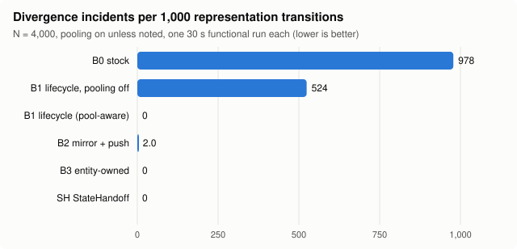
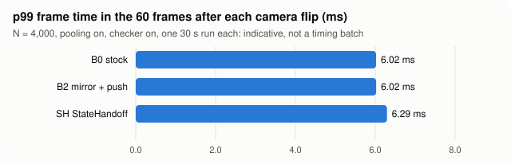

# P09 · StateHandoff: gameplay state that survives LOD switches

**Author:** Krish Gangani · [github.com/KrishGangani](https://github.com/KrishGangani)

**Domain:** Large-scale gameplay architecture · data-oriented design · **Difficulty:** ★★★★★ · **Engine:** UE 5.8.4

> **Status: v1 complete (2026-11-21).** The workload, the invariant checker, four baselines and a minimal StateHandoff (the commit-time hand-off) are built, tested (12 automation tests) and packaged with 0 warnings. The numbers below come from **single 30-second functional runs**, not the planned measurement batches, which were cancelled when the project was closed; what is unmeasured is marked in [09](Explanation/09_Testing_And_Benchmarks.md). The success criteria were fixed before any code.

| Phase | 1 Problem | 2 Research | 3 Architecture | 4 Foundation | 5 Implementation | 6 Explanation | 7 Testing | 8 Profiling | 9 Review | 10 Portfolio |
|---|---|---|---|---|---|---|---|---|---|---|
| State | ✓ | ✓ | ✓ final | ✓ | ✓ v1 (S1–S3a in full, S4–S5 minimal, S6–S8 not built) | ✓ | functional runs | not run | per step | ✓ concise |

---

## Problem statement

Unreal's Mass framework switches each agent between a full **actor**, an **instanced mesh** and **nothing** as its level of detail changes. The engine carries the agent's position, movement and orientation across every switch. It does not carry the state that actor-side systems keep: health, cooldowns, AI memory, reserved interaction slots. Each project hand-writes that hand-off per actor class, and nothing checks it. Epic, on its Gameplay Ability System with Mass: "There are issues with needing to track the state of the ASC, effects, abilities, and stats persist between LOD changes since Actor representation changes." Details: [Explanation/01_Problem_Analysis.md](Explanation/01_Problem_Analysis.md).

## What already exists (and what Phase 2 changed)

- The engine's translators copy **only spatial data** (transform, location, orientation, velocity, capsule transform). Verified in the 5.8.4 source; the one other translator, for BehaviorTree, is an empty stub.
- State owned by Mass-native systems (Mass StateTree, Mass Smart Object claims) **already survives** a switch, so it is out of scope.
- The engine offers **hooks** (spawn callbacks, pooling callbacks, trait initializers), and Epic published a hand-written "hydrate in `BeginPlay`, dehydrate in `EndPlay`" pattern in 2026 (the PersistenceLab sample). This project credits it and measures it as a baseline.
- What is still missing, among the public sources reviewed: an explicit **ownership contract** tied to the representation **commit** (Mass decouples actor lifetime from the representation: queued and budgeted destruction, pooling without `EndPlay`, kept-disabled actors), a **generic** hand-off, an **automated checker**, and a **controlled measurement**. The gap is medium for the mechanism and strong for the contract, checker and measurement. Details: [Explanation/01b_Research_Findings.md](Explanation/01b_Research_Findings.md) §6.

## Engineering approach

Each state field declares its owner: the actor while the entity is **bound** to an enabled actor, the entity otherwise. A Mass processor that runs right after the engine finalises the representation moves ownership (capture actor → entity, restore entity → actor) through one generic, reflection-based path. Two more paths cover the releases that processor can't see in time: an immediate template swap, and an actor ending play behind Mass's back. An **invariant checker** replays the same gameplay events on an independent reference model and classifies every mismatch as lost, duplicated, corrupted, or a reservation double-held or leaked. Fault injection proves the checker sees real faults. Details: [Explanation/02_System_Architecture.md](Explanation/02_System_Architecture.md).

## Success criteria (targets, defined before implementation)

| # | Criterion | Target |
|---|---|---|
| SC1 | Divergence incidents per 1,000 transitions, StateHandoff | **0**, over ≥ 20,000 transitions per config per batch (95% upper bound reported) |
| SC2 | The checker detects injected faults | 100% of injected faults detected |
| SC3 | The problem is real | At least one established pattern shows > 0 incidents; if none does, that is reported plainly |
| SC4 | Hand-off cost per transition | median ≤ 2 µs, p99 ≤ 10 µs |
| SC5 | Frame spikes during mass LOD flips | p99 ≤ stock + 0.5 ms; no extra frames > 33.3 ms |
| SC6 | Steady-state overhead | ≤ +0.10 ms game thread at N = 4,000 |
| SC7 | Memory per agent | bookkeeping ≤ 32 bytes per entity; a full table per representation |
| SC8 | Lifetime safety | 0 crashes, ensures or errors |

Full definitions and reasons: [01_Problem_Analysis.md §6.4](Explanation/01_Problem_Analysis.md).

## Architecture diagram

Final (v1.0): [Explanation/02_System_Architecture.md](Explanation/02_System_Architecture.md) §5–6 (mermaid).

## Results (single functional runs)

The same workload in every configuration: 4,000 Mass agents, a camera that orbits and jumps between two hot spots every 4 s, seeded gameplay events on every agent, and an independent checker that compares each agent's state with a reference model after every frame.



| Configuration | Transitions | Incidents per 1,000 | Batch |
|---|---|---|---|
| B0 stock (state on the actor) | 30,117 | 978.0 | `s5_sh` |
| B1 Epic's lifecycle pattern, pooling off | 30,092 | 524.0 | `s3a_p0` |
| B1 Epic's lifecycle pattern (pool-aware), pooling on | 30,117 | 0 | `s3a_p1` |
| B2 per-frame mirror + push on spawn | 30,115 | 1.96 | `s5_sh` |
| B3 entity-owned (no actor copy) | 30,117 | 0 | `s3a_b3p1` |
| **SH StateHandoff** | **29,871** | **0** (95% upper bound ≈ 0.10) | `s5_sh` |

All with pooling on unless stated, checker on, one 30 s run each. Why B1 depends on pooling: Mass destroys released actors in a time-sliced queue, so `EndPlay` can come frames late; with pooling, every queued actor is pooled in the release frame and a pool-aware `PrepareForPooling` runs in time ([09](Explanation/09_Testing_And_Benchmarks.md), S3a).



In the 60 frames after each camera flip, SH's p99 frame time was 6.29 ms against B0's 6.02 ms (+0.27 ms, inside SC5's 0.5 ms bound), with no frame above 8.3 ms. That run had the checker on, so it is indicative, not a timing result. StateHandoff's own processor took 0.036 ms per frame at the median and 0.243 ms at p99 for 4,000 entities.

**Success criteria** ([09](Explanation/09_Testing_And_Benchmarks.md) has the full table): SC1 ✅ for pooling on (one run); SC3 ✅; SC5 ✅ indicative; SC8 partial; **SC2, SC4, SC6, SC7 not measured** (fault injection, per-transition timing, the parked timing run and the memory dump were not built or run).

Raw data and protocol: [Benchmarks/](Benchmarks/README.md).

## Scope and limits

Single-player only: there is no Iris path for Mass entity replication in UE 5.8.4 (verified in the source). Mass is **Experimental** and was restructured in 5.7 and 5.8, so everything is pinned to 5.8.4. CitySample is used as a reference only.

v1 limits: StateHandoff does not yet capture an actor released immediately (a template swap) or destroyed by gameplay while bound; there is no fault injection, per-transition timing or debug view; the demo's four channels stand in for GAS and blackboards. The growth path is in [12](Explanation/12_Future_Scalability.md).

## Source code

The UE project is in [StateHandoff/](StateHandoff/) (UE 5.8.4, C++):
- the reusable system is the plugin `StateHandoffCore` (it depends on the MassGameplay plugin);
- the workload, baselines and benchmark code go in the game module `StateHandoff`.

## Documentation

| File | Contents |
|---|---|
| [00_Project_Overview](Explanation/00_Project_Overview.md) | Identity, demonstration, presentation, industry relevance |
| [01_Problem_Analysis](Explanation/01_Problem_Analysis.md) | Problem, existing work, root-cause hypotheses, success criteria, measurement plan |
| [01b_Research_Findings](Explanation/01b_Research_Findings.md) | Phase 2: verified engine behaviour (UE 5.8.4), existing work, the revised gap |
| [02_System_Architecture](Explanation/02_System_Architecture.md) | Final v1.0: modules, classes, commit-time hand-off, data flow, safety rules, rejected alternatives |
| [03_Implementation_Roadmap](Explanation/03_Implementation_Roadmap.md) | The small, ordered build steps; the checker and the baselines come before the hand-off |
| [04](Explanation/04_CPP_Fundamentals.md) · [05](Explanation/05_Line_By_Line_Code_Explanation.md) · [06](Explanation/06_Unreal_APIs_And_Macros.md) · [07](Explanation/07_Common_Mistakes.md) | C++ fundamentals, line-by-line code, APIs and macros, common mistakes. Current to Phase 4 |
| [09](Explanation/09_Testing_And_Benchmarks.md) | Every check and benchmark batch, with its raw-data batch name |
| [08](Explanation/08_Debugging_And_Profiling.md) · [10](Explanation/10_Interview_Questions.md) · [11](Explanation/11_Optimization_Decisions.md) · [12](Explanation/12_Future_Scalability.md) | Filled in during Phases 7–10 |
| [Phase2_Raw_Notes/](Explanation/Phase2_Raw_Notes/README.md) | The audit trail behind `01b` |
| [Research/](Explanation/Research/) | The portfolio-wide research this project draws on: job market, technical challenges, existing solutions, local engine verification |

## Folder layout

```text
P09_StateHandoff\
├── README.md        ← this page
├── Explanation\     ← 00–12, Phase2_Raw_Notes\, Research\
├── Benchmarks\      ← Raw\ + Summaries\, and the run protocol
├── Media\           ← diagrams, screenshots, demo video
├── Tools\           ← build/package/smoke scripts; CPU pinning; later the stats and run scripts
└── StateHandoff\    ← the Unreal Engine project (.uproject, Source, Plugins, Config)
```

## License

MIT, see [LICENSE](LICENSE). Unreal Engine itself is not included and is covered by Epic Games' own license.
